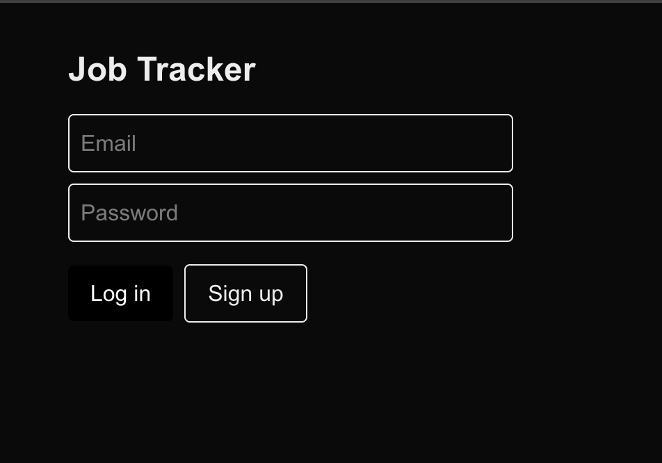
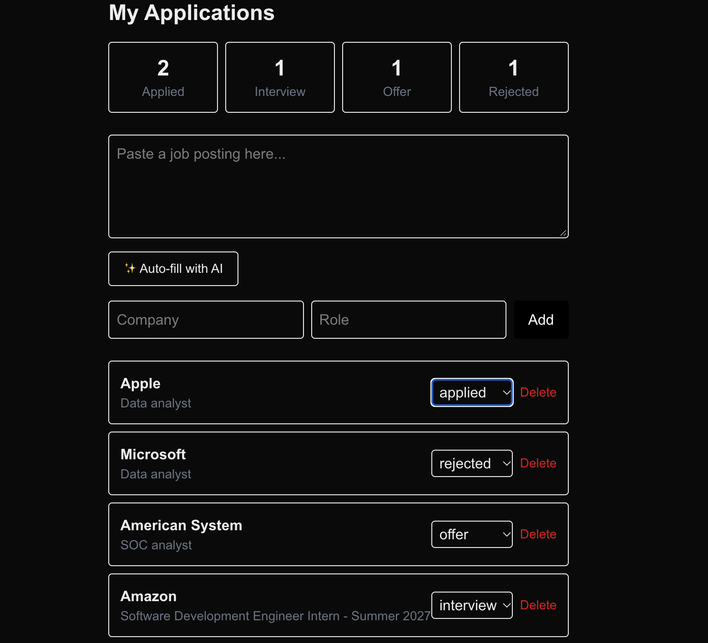

# Job Tracker

A full-stack job application tracker built with Next.js, Supabase, and the Claude API.

## Live Demo
https://job-tracker-woad-delta.vercel.app

## Features
- User authentication (sign up, log in)
- Add, update, and delete job applications
- Track status: applied, interview, offer, rejected
- Dashboard with live application counts
- Row-level security so each user only sees their own data
- AI-powered auto-fill: paste a job posting and Claude extracts the company and role (coming soon)

## Tech Stack
- **Frontend:** Next.js, React, Tailwind CSS
- **Backend:** Supabase (PostgreSQL, Auth, Row Level Security)
- **AI:** Anthropic Claude API
- **Deployment:** Vercel

## Screenshots

## What I Learned
- Building full-stack auth flows with Supabase
- Writing SQL with row-level security policies
- Integrating a third-party AI API into a Next.js app
- Deploying a full-stack app to production
